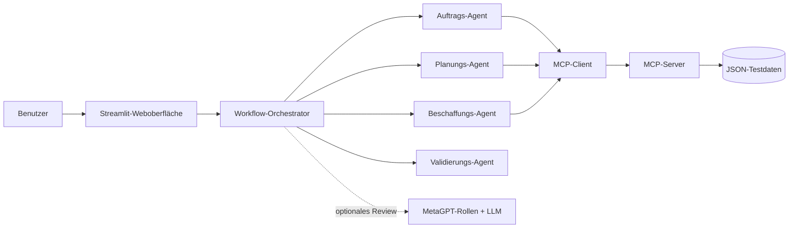

# OrderFlow AI – Multi-Agenten-Prototyp mit MetaGPT und MCP

OrderFlow AI ist ein interaktiver Prototyp für die KI-gestützte Automatisierung eines
Auftragsabwicklungsprozesses. Eine Weboberfläche zeigt, wie spezialisierte Agenten einen Auftrag
prüfen, Unternehmensdaten über das **Model Context Protocol (MCP)** abrufen und eine
nachvollziehbare Entscheidung vorbereiten.

Das Projekt wurde für eine wissenschaftliche Ausarbeitung im Bereich Business Process Management
entwickelt. Der Fokus liegt auf der IT-bezogenen Umsetzung; die simulierten Geschäftsdaten ersetzen
im Prototyp reale ERP-, CRM-, Lager- und Produktionssysteme.

## Funktionen

- Interaktive Streamlit-Weboberfläche mit sichtbarem Workflow
- Rollenbasierte Agentenkoordination für Auftrag, Planung, Beschaffung und Validierung
- MCP-Server mit sechs klar definierten Werkzeugen
- Bonitäts-, Bestands-, Kapazitäts-, Beschaffungs-, Preis- und Lieferterminprüfung
- Vier vorbereitete Demoszenarien sowie freie Eingabe
- Regelbasierte, reproduzierbare Kernentscheidung
- Optionales MetaGPT-Review zur Erklärung und Plausibilisierung
- Ereignisprotokoll und strukturierte MCP-Ergebnisse für die Evaluation
- Automatisierte Tests und GitHub-Actions-Workflow

## Architektur



Die fachliche Entscheidung ist bewusst deterministisch. MetaGPT kann die Ergebnisse erklären und
prüfen, darf aber keine Bestände, Preise, Bonitätswerte oder Entscheidungen verändern. Dadurch ist
die Demo auch ohne API-Schlüssel vollständig lauffähig und ihre Ergebnisse bleiben reproduzierbar.

Mehr Details: [Architektur](docs/architecture.md)

## Schnellstart auf macOS

Voraussetzung ist **Python 3.11**. Diese Version erfüllt gleichzeitig die Anforderungen von
MetaGPT und der verwendeten MCP-Version.

```bash
brew install python@3.11
cd /Users/justin/GitHub-Repo/MultiAgentenMCP
make setup
make run
```

Anschließend öffnet sich die Anwendung normalerweise unter
[http://localhost:8501](http://localhost:8501).

Falls MetaGPT mit einem echten Sprachmodell getestet werden soll, wird es wegen seiner älteren
Abhängigkeiten bewusst in einer zweiten virtuellen Umgebung isoliert:

```bash
make setup-metagpt
# Danach den API-Schlüssel in config/config2.yaml eintragen.
make run
```

Das Setup kopiert bei Bedarf `config/config2.example.yaml` nach `config/config2.yaml`. Die offizielle
MetaGPT-Version referenziert zusätzlich einige veraltete oder für diesen Rollen-Workflow nicht
benötigte Komponenten, darunter `lancedb==0.4.0`. Diese werden ausgelassen; anschließend werden die
tatsächlich verwendeten Klassen `Action` und `Role` durch einen Importtest geprüft.

Der API-Schlüssel wird ausschließlich in der lokalen MetaGPT-Konfiguration hinterlegt und niemals
in dieses Repository eingecheckt. In der Weboberfläche kann danach „MetaGPT-Review verwenden“
aktiviert werden.

## Demoablauf

1. `make run` ausführen.
2. Eines der vorbereiteten Szenarien auswählen.
3. „Auftrag starten“ anklicken.
4. Live verfolgen, welcher Agent welches MCP-Werkzeug verwendet.
5. Entscheidung, Kennzahlen, MCP-Ergebnisse und Agentenprotokoll vergleichen.

| Szenario | Eingabe | Erwartete Entscheidung |
|---|---|---|
| Normalfall | C100, P100, 10 Stück | Auftrag bestätigen |
| Produktion erforderlich | C100, P100, 30 Stück | Fehlmenge intern produzieren |
| Beschaffung erforderlich | C100, P100, 80 Stück | Fehlmenge extern beschaffen |
| Bonität gesperrt | C200, P100, 10 Stück | Manuelle Prüfung |

Ein ausformulierter Vorführungsplan steht im [Demo-Leitfaden](docs/demo-guide.md).

## MCP-Werkzeuge

| Werkzeug | Zweck | Simuliertes System |
|---|---|---|
| `get_customer` | Kundenstammdaten und Bonität | CRM |
| `check_stock` | Bestand und Fehlmenge | Lagerverwaltung |
| `check_capacity` | interne Produktionskapazität | PPS/MES |
| `check_procurement` | externe Beschaffungsoption | Einkauf/SRM |
| `calculate_price` | Preis und Mengenrabatt | ERP/Kalkulation |
| `calculate_delivery_date` | zugesagter Liefertermin | ERP/Disposition |

Der MCP-Server lässt sich separat mit dem offiziellen Inspector untersuchen:

```bash
make mcp-inspector
```

Alternativ kann er per Streamable HTTP gestartet werden:

```bash
make mcp-http
```

## Tests und Kommandozeile

```bash
make check
make cli
.venv/bin/orderflow-demo --scenario procurement
```

`make check` führt Linting und alle automatisierten Tests aus. Die GitHub Action wiederholt diese
Prüfungen bei jedem Push und Pull Request.

## Projektstruktur

```text
MultiAgentenMCP/
├── data/                       # simulierte Unternehmensdaten
├── docs/                       # Architektur, Demo und Evaluation
├── src/orderflow/
│   ├── mcp_server.py          # MCP-Werkzeuge
│   ├── mcp_client.py          # MCP-Aufrufe des Workflows
│   ├── workflow.py            # Orchestrierung und Entscheidung
│   ├── metagpt_agents.py      # optionales MetaGPT-Review
│   ├── models.py              # Datenmodelle
│   └── cli.py                 # Kommandozeilen-Demo
├── tests/                      # automatisierte Tests
├── streamlit_app.py            # Weboberfläche
├── pyproject.toml              # Abhängigkeiten und Tool-Konfiguration
└── Makefile                    # Kurzbefehle
```

## Abgrenzung

Der Prototyp erzeugt keine realen Kundenaufträge und schreibt nicht in operative Systeme. Die
JSON-Dateien sind bewusst kleine, transparente Testdatenbestände. In einer produktiven Umgebung
würden die MCP-Werkzeuge durch abgesicherte Adapter für ERP, CRM, Lager, PPS und Einkauf ersetzt.
Authentifizierung, Rechtekonzept, Protokollierung, Datenschutz, Transaktionen und menschliche
Freigaben müssten dort zusätzlich umgesetzt werden.

## Bezug zur wissenschaftlichen Ausarbeitung

Die technische Umsetzung eignet sich insbesondere als Grundlage für:

- Architektur und Integrationskonzept
- Agentenmodell, Rollen, Koordination und Kooperation
- MCP-Integration und Werkzeugaufrufe
- prototypische Implementierung und Demo
- Evaluation anhand definierter Testszenarien
- Grenzen, Risiken und Weiterentwicklung

Eine kompakte Zuordnung zu den Kapiteln der Ausarbeitung befindet sich in
[Kapitelzuordnung](docs/report-mapping.md).
