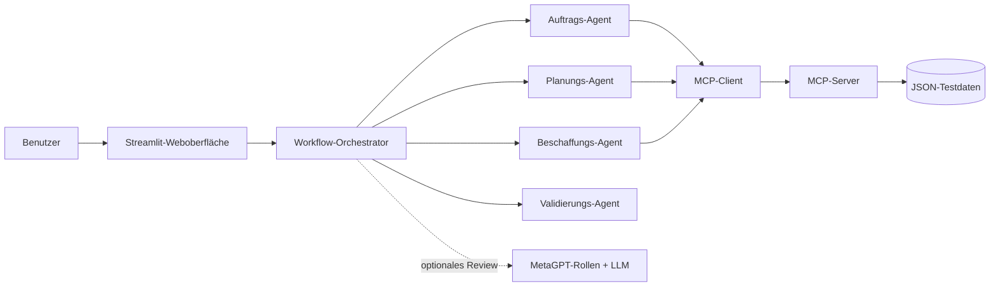

# OrderFlow AI – Multi-Agenten-Prototyp mit MetaGPT und MCP

OrderFlow AI ist ein interaktiver Prototyp für die KI-gestützte Automatisierung eines
Auftragsabwicklungsprozesses. Eine Weboberfläche zeigt, wie spezialisierte Agenten einen Auftrag
prüfen, Unternehmensdaten über das **Model Context Protocol (MCP)** abrufen und eine
nachvollziehbare Entscheidung vorbereiten.

Das Projekt wurde für eine wissenschaftliche Ausarbeitung im Bereich Business Process Management
entwickelt. Der Fokus liegt auf der IT-bezogenen Umsetzung; die simulierten Geschäftsdaten ersetzen
im Prototyp reale ERP-, CRM-, Lager- und Produktionssysteme.

## Funktionen

- Interaktive Streamlit-Weboberfläche mit sichtbarem Workflow
- Animierte Prozesskette und ein wählbarer Präsentationsmodus
- Rollenbasierte Agentenkoordination für Auftrag, Planung, Beschaffung und Validierung
- MCP-Server mit sechs klar definierten Werkzeugen
- Bonitäts-, Bestands-, Kapazitäts-, Beschaffungs-, Preis- und Lieferterminprüfung
- Transparente Produktionsdauer aus Rüstzeit, Tageskapazität und Fehlmenge
- Lokales Anlegen neuer Demo-Kunden und -Produkte über die Weboberfläche
- Vollständige Kunden- und Produktverwaltung in einem hervorgehobenen Dialogfenster
- Bestätigungspflichtiges Löschen einschließlich abhängiger Demo-Stammdaten
- Vier vorbereitete Demoszenarien sowie freie Eingabe
- Regelbasierte, reproduzierbare Kernentscheidung
- Optionale MetaGPT-Erklärung mit drei getrennt dargestellten Rollen
- Ereignisprotokoll und strukturierte MCP-Ergebnisse für die Evaluation
- Durchgängig deutsche Benutzeroberfläche einschließlich übersetzter Ergebnisfelder
- Automatisierte Tests und GitHub-Actions-Workflow

## Architektur



Die fachliche Entscheidung ist bewusst deterministisch. MetaGPT kann die Ergebnisse erklären und
prüfen, darf aber keine Bestände, Preise, Bonitätswerte oder Entscheidungen verändern. Dadurch ist
die Demo auch ohne API-Schlüssel vollständig lauffähig und ihre Ergebnisse bleiben reproduzierbar.

Mehr Details: [Architektur](docs/architecture.md)

## Schnellstart auf Windows, Linux und macOS

Voraussetzung für die native Installation ist **Python 3.11**. Nach dem Start ist die Anwendung
auf allen Plattformen unter [http://localhost:8501](http://localhost:8501) erreichbar.

### Windows

1. Python 3.11 von [python.org](https://www.python.org/downloads/) installieren und dabei
   „Add Python to PATH“ aktivieren.
2. `setup-windows.cmd` doppelt anklicken und die Installation abwarten.
3. Danach `start-windows.cmd` doppelt anklicken.

Alternativ können beide Dateien aus PowerShell oder der Eingabeaufforderung gestartet werden.

### Linux

```bash
cd MultiAgentenMCP
chmod +x scripts/setup_unix.sh scripts/run_unix.sh
./scripts/setup_unix.sh
./scripts/run_unix.sh
```

Unter Ubuntu oder Debian muss Python 3.11 gegebenenfalls vorher über die Paketverwaltung
installiert werden. Mit `PYTHON=/pfad/zu/python3.11 ./scripts/setup_unix.sh` kann ein bestimmter
Interpreter ausgewählt werden.

### macOS

```bash
brew install python@3.11
cd MultiAgentenMCP
./scripts/setup_unix.sh
./scripts/run_unix.sh
```

Die bisherigen Make-Befehle (`make setup`, `make run`) funktionieren unter macOS und Linux
weiterhin.

### Plattformunabhängig mit Docker

Wenn Docker Desktop beziehungsweise Docker Engine installiert ist, läuft die Basisanwendung auf
Windows, Linux und macOS identisch:

```bash
docker compose up --build
```

Die Demo-Stammdaten werden über `./data` eingebunden und bleiben dadurch nach einem Neustart des
Containers erhalten. Beendet wird die Anwendung mit `docker compose down`.

Der Server lauscht bewusst auf `0.0.0.0`. Dadurch können andere Geräte im selben lokalen Netzwerk
die Anwendung über `http://IP-DES-RECHNERS:8501` öffnen, sofern die Firewall Port 8501 zulässt.

Falls MetaGPT mit einem echten Sprachmodell getestet werden soll, wird es wegen seiner älteren
Abhängigkeiten bewusst in einer zweiten virtuellen Umgebung isoliert:

Linux/macOS:

```bash
.venv/bin/python scripts/setup_metagpt.py
```

Windows:

```powershell
.\.venv\Scripts\python.exe scripts\setup_metagpt.py
```

Danach wird der API-Schlüssel in `config/config2.yaml` eingetragen und die Anwendung erneut
gestartet. Das Docker-Abbild enthält bewusst nur die vollständig offline nutzbare Basisanwendung;
für die optionale MetaGPT-Laufzeit wird die native Installation empfohlen.

Das Setup kopiert bei Bedarf `config/config2.example.yaml` nach `config/config2.yaml`. Die offizielle
MetaGPT-Version referenziert zusätzlich einige veraltete oder für diesen Rollen-Workflow nicht
benötigte Komponenten, darunter `lancedb==0.4.0`. Diese werden ausgelassen; anschließend werden die
tatsächlich verwendeten Klassen `Action` und `Role` durch einen Importtest geprüft.

Der API-Schlüssel wird ausschließlich in der lokalen MetaGPT-Konfiguration hinterlegt und niemals
in dieses Repository eingecheckt. In der Weboberfläche kann danach „Erklärung durch MetaGPT
aktivieren“ ausgewählt werden.

## Demoablauf

1. Den passenden Startbefehl für das Betriebssystem ausführen.
2. Eines der vorbereiteten Szenarien auswählen.
3. „Auftrag starten“ anklicken.
4. Im Präsentationsmodus live verfolgen, welche Rolle welches MCP-Werkzeug verwendet.
5. Im Bereich „So wurde gerechnet“ die Produktions-, Preis- und Terminformeln erläutern.
6. Die drei MetaGPT-Rollen Anna, Paul und Vera miteinander vergleichen.
7. Über „Stammdaten verwalten“ den kompakten Verwaltungsdialog öffnen.
8. Kunden und Produkte dort anzeigen, anlegen, bearbeiten oder kontrolliert löschen.

| Szenario | Eingabe | Erwartete Entscheidung |
|---|---|---|
| Normalfall | C100, P100, 10 Stück | Auftrag bestätigen |
| Produktion erforderlich | C100, P100, 30 Stück | Fehlmenge intern produzieren |
| Beschaffung erforderlich | C100, P100, 80 Stück | Fehlmenge extern beschaffen |
| Bonität gesperrt | C200, P100, 10 Stück | Manuelle Prüfung |

Ein ausformulierter Vorführungsplan steht im [Demo-Leitfaden](docs/demo-guide.md).

## MCP-Werkzeuge

| Werkzeug | Zweck | Simuliertes System |
|---|---|---|
| `get_customer` | Kundenstammdaten und Bonität | CRM |
| `check_stock` | Bestand und Fehlmenge | Lagerverwaltung |
| `check_capacity` | interne Produktionskapazität | PPS/MES |
| `check_procurement` | externe Beschaffungsoption | Einkauf/SRM |
| `calculate_price` | Preis und Mengenrabatt | ERP/Kalkulation |
| `calculate_delivery_date` | zugesagter Liefertermin | ERP/Disposition |

## Nachvollziehbare Produktionsdauer

Die Produktionsdauer ist kein fester, vom Sprachmodell erfundener Wert. Das MCP-Werkzeug berechnet
sie nach einer transparenten Regel:

`Produktionsdauer = Rüst- und Planungstage + aufrunden(Fehlmenge / Tageskapazität)`

Die Tageskapazität ergibt sich aus der Wochenkapazität geteilt durch die Arbeitstage pro Woche.
Bei P300 und 20 fehlenden Drucksensoren entstehen so zwei Rüst- und Planungstage plus ein
Produktionstag, also drei Arbeitstage. Die Lieferterminberechnung überspringt Wochenenden.

Eine Wochenkapazität ist dabei keine harte Auftragsgrenze. Reicht eine Woche nicht aus, prüft der
Orchestrator zunächst eine vollständige externe Beschaffung und verwendet andernfalls eine
mehrwöchige interne Produktion. Ein Liefertermin wird nur zugesagt, wenn mindestens ein Weg die
gesamte Fehlmenge abdeckt. Teilmengen eines Lieferanten werden deshalb nie als vollständige
Erfüllung gewertet.

Der MCP-Server lässt sich separat mit dem offiziellen Inspector untersuchen:

```bash
make mcp-inspector
```

Alternativ kann er per Streamable HTTP gestartet werden:

```bash
make mcp-http
```

## Tests und Kommandozeile

```bash
make check
make cli
.venv/bin/orderflow-demo --scenario procurement
```

`make check` führt Linting und alle automatisierten Tests aus. Die GitHub Action wiederholt diese
Prüfungen bei jedem Push und Pull Request.

Unter Windows lassen sich dieselben Prüfungen mit
`.venv\Scripts\python.exe -m pytest` und
`.venv\Scripts\python.exe -m ruff check .` starten.

## Projektstruktur

```text
MultiAgentenMCP/
├── data/                       # simulierte Unternehmensdaten
├── docs/                       # Architektur, Demo und Evaluation
├── src/orderflow/
│   ├── mcp_server.py          # MCP-Werkzeuge
│   ├── mcp_client.py          # MCP-Aufrufe des Workflows
│   ├── workflow.py            # Orchestrierung und Entscheidung
│   ├── metagpt_agents.py      # optionales MetaGPT-Review
│   ├── models.py              # Datenmodelle
│   └── cli.py                 # Kommandozeilen-Demo
├── tests/                      # automatisierte Tests
├── scripts/                    # Start- und Installationsskripte für Unix und Windows
├── streamlit_app.py            # Weboberfläche
├── Dockerfile / compose.yaml   # plattformunabhängiger Containerstart
├── setup-windows.cmd           # Windows-Installation per Doppelklick
├── start-windows.cmd           # Windows-Start per Doppelklick
├── pyproject.toml              # Abhängigkeiten und Tool-Konfiguration
└── Makefile                    # Kurzbefehle
```

## Abgrenzung

Der Prototyp erzeugt keine realen Kundenaufträge und schreibt nicht in operative Systeme. Die
JSON-Dateien sind bewusst kleine, transparente Testdatenbestände. In einer produktiven Umgebung
würden die MCP-Werkzeuge durch abgesicherte Adapter für ERP, CRM, Lager, PPS und Einkauf ersetzt.
Authentifizierung, Rechtekonzept, Protokollierung, Datenschutz, Transaktionen und menschliche
Freigaben müssten dort zusätzlich umgesetzt werden.

## Bezug zur wissenschaftlichen Ausarbeitung

Die technische Umsetzung eignet sich insbesondere als Grundlage für:

- Architektur und Integrationskonzept
- Agentenmodell, Rollen, Koordination und Kooperation
- MCP-Integration und Werkzeugaufrufe
- prototypische Implementierung und Demo
- Evaluation anhand definierter Testszenarien
- Grenzen, Risiken und Weiterentwicklung

Eine kompakte Zuordnung zu den Kapiteln der Ausarbeitung befindet sich in
[Kapitelzuordnung](docs/report-mapping.md).
