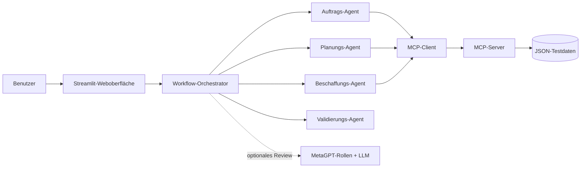

# OrderFlow AI – Multi-Agenten-Prototyp mit MetaGPT und MCP

OrderFlow AI ist ein interaktiver Prototyp für die KI-gestützte Automatisierung eines
Auftragsabwicklungsprozesses. Eine Weboberfläche zeigt, wie spezialisierte Agenten einen Auftrag
prüfen, Unternehmensdaten über das **Model Context Protocol (MCP)** abrufen und eine
nachvollziehbare Entscheidung vorbereiten.

Das Projekt wurde für eine wissenschaftliche Ausarbeitung im Bereich Business Process Management
entwickelt. Der Fokus liegt auf der IT-bezogenen Umsetzung; die simulierten Geschäftsdaten ersetzen
im Prototyp reale ERP-, CRM-, Lager- und Produktionssysteme.

## Funktionen

- Interaktive Streamlit-Weboberfläche mit sichtbarem Workflow
- Animierte Prozesskette und ein wählbarer Präsentationsmodus
- Rollenbasierte Agentenkoordination für Auftrag, Planung, Beschaffung und Validierung
- MCP-Server mit sechs klar definierten Werkzeugen
- Bonitäts-, Bestands-, Kapazitäts-, Beschaffungs-, Preis- und Lieferterminprüfung
- Transparente Produktionsdauer aus Rüstzeit, Tageskapazität und Fehlmenge
- Lokales Anlegen neuer Demo-Kunden und -Produkte über die Weboberfläche
- Vollständige Kunden- und Produktverwaltung in einem hervorgehobenen Dialogfenster
- Tabellenaktionen direkt pro Zeile: Bearbeiten und Löschen mit klaren Vektor-Icons
- Bestätigungspflichtiges Löschen einschließlich abhängiger Demo-Stammdaten
- Vier vorbereitete Demoszenarien sowie freie Eingabe
- Regelbasierte, reproduzierbare Kernentscheidung
- Optionale MetaGPT-Erklärung mit drei getrennt dargestellten Rollen
- Auftragsbezogene MetaGPT-Kontextkette: Anna → Paul → Vera
- Ereignisprotokoll und strukturierte MCP-Ergebnisse für die Evaluation
- Durchgängig deutsche Benutzeroberfläche einschließlich übersetzter Ergebnisfelder
- Automatisierte Tests und GitHub-Actions-Workflow

## Architektur



Die fachliche Entscheidung ist bewusst deterministisch. MetaGPT kann die Ergebnisse erklären und
prüfen, darf aber keine Bestände, Preise, Bonitätswerte oder Entscheidungen verändern. Dadurch ist
die Demo auch ohne API-Schlüssel vollständig lauffähig und ihre Ergebnisse bleiben reproduzierbar.

Mehr Details: [Architektur](docs/architecture.md)

Alle in Oberfläche und Dokumentation verwendeten Fachbegriffe stehen zusätzlich im
[Glossar](docs/glossary.md). In der Weboberfläche öffnet die Schaltfläche „Begriffe“ ein
durchsuchbares Glossar; die Prozessschritte und zentralen Kennzahlen besitzen außerdem
Hover-Erklärungen.

## Zentrale Begriffe einfach erklärt

| Begriff | Bedeutung im Prototyp |
|---|---|
| **BPM** | Business Process Management gestaltet und verbessert betriebliche Abläufe. Hier wird die Auftragsabwicklung als digitaler Prozess abgebildet. |
| **Workflow** | Festgelegte Folge von Arbeitsschritten, Regeln und Ergebnissen. |
| **Workflow-Orchestrator** | Zentrale Steuerung, die Prozessschritte startet, Agenten koordiniert, Ergebnisse sammelt und den nächsten Prozessweg auswählt. |
| **KI-Agent** | Softwarekomponente mit einer klaren Rolle und Aufgabe, beispielsweise Planung oder Validierung. |
| **Multi-Agentensystem** | Mehrere spezialisierte Agenten arbeiten koordiniert an einem gemeinsamen Ergebnis. |
| **MetaGPT** | Open-Source-Framework für rollenbasierte Multi-Agentensysteme. Es erzeugt hier verständliche Erklärungen und eine zusätzliche Prüfung. |
| **LLM / Sprachmodell** | KI-Modell zur Verarbeitung und Erzeugung von Sprache. Es formuliert Texte, bestimmt aber keine Geschäftswerte. |
| **MCP** | Model Context Protocol: standardisiertes Protokoll, über das KI-Anwendungen Werkzeuge und Datenquellen kontrolliert verwenden können. |
| **MCP-Client** | Anfragende Komponente, die strukturierte Werkzeugaufrufe an den MCP-Server sendet und Ergebnisse entgegennimmt. |
| **MCP-Server** | Anbietende Komponente, die definierte Werkzeuge bereitstellt, Parameter prüft und strukturierte Ergebnisse zurückliefert. |
| **MCP-Werkzeug** | Klar begrenzte Serverfunktion, zum Beispiel Bestand prüfen oder Liefertermin berechnen. |
| **Strukturierte Daten / JSON** | Daten mit eindeutig benannten Feldern, die zuverlässig maschinell verarbeitet werden können. |
| **CRM** | Customer Relationship Management für Kundenstammdaten und Bonitätsstatus. |
| **ERP** | Enterprise Resource Planning für Aufträge, Preise, Materialien und weitere Unternehmensressourcen. |
| **PPS / MES** | Systeme für Produktionsplanung, Kapazitäten sowie operative Fertigung und Überwachung. |
| **SRM** | Supplier Relationship Management für Lieferanten und Beschaffungsbedingungen. |
| **Bonität** | Einschätzung der Zahlungsfähigkeit eines Kunden. Nicht freigegebene Fälle werden manuell geprüft. |
| **Fehlmenge** | Teil der bestellten Menge, der nicht auf Lager liegt und produziert oder beschafft werden muss. |
| **Durchlaufzeit** | Benötigte Arbeitszeit vom Planungsbeginn bis zur vollständigen Bereitstellung. |
| **Regelbasierte Entscheidung** | Reproduzierbare Entscheidung nach festen Bedingungen; MetaGPT darf sie erklären und prüfen, aber nicht verändern. |
| **Validierung** | Kontrolle, ob Daten, Berechnung, Entscheidung und Erklärung widerspruchsfrei zusammenpassen. |
| **Prototyp** | Vereinfachte, funktionsfähige Umsetzung zur Demonstration und Evaluation, noch kein produktives Unternehmenssystem. |

### Zusammenspiel der Komponenten

1. Der Benutzer erfasst den Auftrag in der Weboberfläche.
2. Der **Workflow-Orchestrator** koordiniert die fachlichen Schritte und Agenten.
3. Der **MCP-Client** ruft definierte Werkzeuge des **MCP-Servers** auf.
4. Der MCP-Server ermittelt Kunden-, Bestands-, Kapazitäts-, Preis- und Termindaten.
5. Der regelbasierte Workflow vergleicht alle vollständigen Erfüllungswege und wählt den
   schnellsten. Bei gleicher Dauer wird reproduzierbar die interne Produktion bevorzugt.
6. Die optionalen **MetaGPT-Agenten** arbeiten nacheinander: Anna ordnet den Auftrag ein, Paul
   reagiert darauf und vergleicht die Erfüllungswege, Vera prüft beide Beiträge gegen die Fakten.

### Gemeinsamer Kontext der MetaGPT-Rollen

Die Rollen erhalten nicht lediglich dreimal denselben freien Text. Jeder Durchlauf erzeugt eine
auftragsbezogene Kontextkette:

1. **Anna – Auftragssicht:** erhält den kontrollierten Faktenblock und beschreibt Kundenwunsch,
   Bonität und geschäftliche Folge ohne Detailrechnung.
2. **Paul – Planungssicht:** erhält denselben Faktenblock sowie Annas Beitrag. Er vermeidet deren
   Wiederholung, vergleicht vollständige Produktions- und Beschaffungswege und erklärt die Auswahl.
3. **Vera – Prüfsicht:** erhält Fakten sowie beide vorherigen Beiträge. Sie gleicht Bonität,
   Erfüllungsweg, Preis und Termin ab und benennt mögliche Widersprüche.

Die Kontextkette gilt bewusst nur für einen Auftrag. Zwischen verschiedenen Aufträgen wird kein
Langzeitgedächtnis übernommen, damit alte Kunden- oder Auftragsdaten nicht in einen neuen Vorgang
gelangen. Die Agenten dürfen Formulierungen selbst erzeugen, aber keine Geschäftswerte erfinden oder
die regelbasierte Entscheidung verändern.

Das vollständige [Glossar](docs/glossary.md) enthält weitere fachliche Einzelbegriffe wie
Rüstzeit, Produktionskapazität, Beschaffung, Stammdaten und zugesagten Liefertermin.

## Schnellstart auf Windows, Linux und macOS

Voraussetzung für die native Installation ist **Python 3.11**. Nach dem Start ist die Anwendung
auf allen Plattformen unter [http://localhost:8501](http://localhost:8501) erreichbar.

### Windows

1. Python 3.11 von [python.org](https://www.python.org/downloads/) installieren und dabei
   „Add Python to PATH“ aktivieren.
2. `start-windows.cmd` doppelt anklicken.
3. Beim ersten Start die automatische Einrichtung abwarten und den persönlichen OpenAI-Schlüssel
   eingeben. Mit Enter kann MetaGPT zunächst übersprungen werden.

Bei jedem weiteren Start genügt derselbe Doppelklick. `setup-windows.cmd` ist nur noch eine
optionale Möglichkeit, die Einrichtung vorab ohne Start der Weboberfläche auszuführen.

### Linux

```bash
cd MultiAgentenMCP
chmod +x start-orderflow.sh
./start-orderflow.sh
```

Unter Ubuntu oder Debian muss Python 3.11 gegebenenfalls vorher über die Paketverwaltung
installiert werden. Der Launcher richtet Basisanwendung und MetaGPT beim ersten Aufruf automatisch
in zwei getrennten virtuellen Umgebungen ein.

### macOS

```bash
brew install python@3.11
cd MultiAgentenMCP
./start-orderflow.sh
```

Die bisherigen Make-Befehle (`make setup`, `make run`) funktionieren unter macOS und Linux
weiterhin.

### Plattformunabhängig mit Docker

Wenn Docker Desktop beziehungsweise Docker Engine installiert ist, läuft die Basisanwendung auf
Windows, Linux und macOS identisch:

```bash
docker compose up --build
```

Die Demo-Stammdaten werden über `./data` eingebunden und bleiben dadurch nach einem Neustart des
Containers erhalten. Beendet wird die Anwendung mit `docker compose down`.

Der Server lauscht bewusst auf `0.0.0.0`. Dadurch können andere Geräte im selben lokalen Netzwerk
die Anwendung über `http://IP-DES-RECHNERS:8501` öffnen, sofern die Firewall Port 8501 zulässt.

MetaGPT wird beim ersten nativen Start automatisch in einer zweiten virtuellen Umgebung isoliert
installiert. Das verhindert Konflikte mit der Webanwendung. Der Launcher übernimmt außerdem den
persönlichen API-Schlüssel, ohne ihn anzuzeigen, und speichert ihn ausschließlich in der von Git
ignorierten Datei `config/config2.yaml`.

Die manuelle Einrichtung bleibt für Fehlerdiagnosen möglich:

Linux/macOS:

```bash
.venv/bin/python scripts/setup_metagpt.py
```

Windows:

```powershell
.\.venv\Scripts\python.exe scripts\setup_metagpt.py
```

Das Docker-Abbild enthält bewusst nur die vollständig offline nutzbare Basisanwendung. Für den
Ein-Klick-Start einschließlich MetaGPT wird die native Variante empfohlen.

Das Setup kopiert bei Bedarf `config/config2.example.yaml` nach `config/config2.yaml`. Die offizielle
MetaGPT-Version referenziert zusätzlich einige veraltete oder für diesen Rollen-Workflow nicht
benötigte Komponenten, darunter `lancedb==0.4.0`. Diese werden ausgelassen; anschließend werden die
tatsächlich verwendeten Klassen `Action` und `Role` durch einen Importtest geprüft.

Der API-Schlüssel wird ausschließlich in der lokalen MetaGPT-Konfiguration hinterlegt und niemals
in dieses Repository eingecheckt. In der Weboberfläche kann danach „MetaGPT-Erklärung erstellen“
ausgewählt werden.

Wurde ein Schlüssel deaktiviert oder soll er ausgetauscht werden, lässt er sich ohne manuelles
Bearbeiten der Konfigurationsdatei ersetzen:

Linux/macOS:

```bash
./start-orderflow.sh --replace-api-key
```

Windows:

```powershell
start-windows.cmd --replace-api-key
```

Der Launcher fragt den neuen Schlüssel verdeckt ab. Alternativ kann unter Linux/macOS einmalig
`OPENAI_API_KEY` gesetzt werden; der Launcher übernimmt den Wert in die lokale, von Git ignorierte
Konfiguration. Eine Meldung `401 token_invalidated` bedeutet nicht, dass Linux oder MetaGPT falsch
installiert ist, sondern dass OpenAI den verwendeten Schlüssel nicht mehr akzeptiert.

## Demoablauf

1. Den passenden Startbefehl für das Betriebssystem ausführen.
2. Eines der vorbereiteten Szenarien auswählen.
3. „Auftrag bearbeiten“ anklicken.
4. Im Präsentationsmodus live verfolgen, welche Rolle welches MCP-Werkzeug verwendet.
5. Im Tab „Berechnung“ die Produktions-, Preis- und Terminformeln erläutern.
6. Die drei MetaGPT-Rollen Anna, Paul und Vera miteinander vergleichen.
7. Über „Stammdaten“ den kompakten Verwaltungsdialog öffnen.
8. Kunden und Produkte dort über „Neu anlegen“ oberhalb der Tabelle ergänzen.
9. Datensätze über die Bearbeiten- und Löschen-Schaltflächen rechts in jeder Zeile verwalten.

| Szenario | Eingabe | Erwartete Entscheidung |
|---|---|---|
| Normalfall | Menge ist vollständig auf Lager | Auftrag bestätigen |
| Produktion erforderlich | Produktion ist der schnellste vollständige Weg | Fehlmenge intern produzieren |
| Beschaffung erforderlich | Lieferant deckt alles schneller ab | Fehlmenge extern beschaffen |
| Bonität nicht freigegeben | Kunde ist gesperrt oder noch in Prüfung | Manuelle Prüfung |

Die konkreten Kunden, Produkte und Mengen werden aus den aktuell gepflegten Stammdaten erzeugt.
Dadurch bleiben die Vorführungsszenarien auch nach dem Anlegen, Bearbeiten oder Löschen von
Demodatensätzen fachlich korrekt. Ein Bonitätsszenario erscheint nur, wenn ein entsprechender
Kunde vorhanden ist.

Ein ausformulierter Vorführungsplan steht im [Demo-Leitfaden](docs/demo-guide.md).

## MCP-Werkzeuge

| Werkzeug | Zweck | Simuliertes System |
|---|---|---|
| `get_customer` | Kundenstammdaten und Bonität | CRM |
| `check_stock` | Bestand und Fehlmenge | Lagerverwaltung |
| `check_capacity` | interne Produktionskapazität | PPS/MES |
| `check_procurement` | externe Beschaffungsoption | Einkauf/SRM |
| `calculate_price` | Preis und Mengenrabatt | ERP/Kalkulation |
| `calculate_delivery_date` | zugesagter Liefertermin | ERP/Disposition |

## Nachvollziehbare Produktionsdauer

Die Produktionsdauer ist kein fester, vom Sprachmodell erfundener Wert. Das MCP-Werkzeug berechnet
sie nach einer transparenten Regel:

`Produktionsdauer = Rüst- und Planungstage + aufrunden(Fehlmenge / Tageskapazität)`

Die Tageskapazität ergibt sich aus der Wochenkapazität geteilt durch die Arbeitstage pro Woche.
Bei P300 und 20 fehlenden Drucksensoren entstehen so zwei Rüst- und Planungstage plus ein
Produktionstag, also drei Arbeitstage. Die Lieferterminberechnung überspringt Wochenenden.

Eine Wochenkapazität ist dabei keine harte Auftragsgrenze. Bei einer Fehlmenge prüft der
Orchestrator interne Produktion und externe Beschaffung immer unabhängig voneinander. Es werden
nur Wege berücksichtigt, welche die gesamte Fehlmenge abdecken. Anschließend wird der Weg mit der
kürzeren Durchlaufzeit ausgewählt; bei gleicher Dauer hat die interne Produktion Vorrang. Reicht
eine Woche nicht aus, kann die interne Produktion auch mehrwöchig geplant werden. Teilmengen eines
Lieferanten werden nie als vollständige Erfüllung gewertet. Ist kein vollständiger Weg vorhanden,
wird kein falscher Liefertermin ausgegeben, sondern eine manuelle Prüfung verlangt.

Der MCP-Server lässt sich separat mit dem offiziellen Inspector untersuchen:

```bash
make mcp-inspector
```

Alternativ kann er per Streamable HTTP gestartet werden:

```bash
make mcp-http
```

## Tests und Kommandozeile

```bash
make check
make cli
.venv/bin/orderflow-demo --scenario procurement
```

`make check` führt Linting und alle automatisierten Tests aus. Die GitHub Action wiederholt diese
Prüfungen bei jedem Push und Pull Request.

Unter Windows lassen sich dieselben Prüfungen mit
`.venv\Scripts\python.exe -m pytest` und
`.venv\Scripts\python.exe -m ruff check .` starten.

## Projektstruktur

```text
MultiAgentenMCP/
├── data/                       # simulierte Unternehmensdaten
├── docs/                       # Architektur, Demo und Evaluation
├── src/orderflow/
│   ├── mcp_server.py          # MCP-Werkzeuge
│   ├── mcp_client.py          # MCP-Aufrufe des Workflows
│   ├── workflow.py            # Orchestrierung und Entscheidung
│   ├── metagpt_agents.py      # optionales MetaGPT-Review
│   ├── models.py              # Datenmodelle
│   └── cli.py                 # Kommandozeilen-Demo
├── tests/                      # automatisierte Tests
├── scripts/                    # Start- und Installationsskripte für Unix und Windows
├── start-orderflow.sh          # Ein-Klick-Start für Linux und macOS
├── streamlit_app.py            # Weboberfläche
├── Dockerfile / compose.yaml   # plattformunabhängiger Containerstart
├── setup-windows.cmd           # Windows-Installation per Doppelklick
├── start-windows.cmd           # Windows-Start per Doppelklick
├── pyproject.toml              # Abhängigkeiten und Tool-Konfiguration
└── Makefile                    # Kurzbefehle
```

## Abgrenzung

Der Prototyp erzeugt keine realen Kundenaufträge und schreibt nicht in operative Systeme. Die
JSON-Dateien sind bewusst kleine, transparente Testdatenbestände. In einer produktiven Umgebung
würden die MCP-Werkzeuge durch abgesicherte Adapter für ERP, CRM, Lager, PPS und Einkauf ersetzt.
Authentifizierung, Rechtekonzept, Protokollierung, Datenschutz, Transaktionen und menschliche
Freigaben müssten dort zusätzlich umgesetzt werden.

## Bezug zur wissenschaftlichen Ausarbeitung

Die technische Umsetzung eignet sich insbesondere als Grundlage für:

- Architektur und Integrationskonzept
- Agentenmodell, Rollen, Koordination und Kooperation
- MCP-Integration und Werkzeugaufrufe
- prototypische Implementierung und Demo
- Evaluation anhand definierter Testszenarien
- Grenzen, Risiken und Weiterentwicklung

Eine kompakte Zuordnung zu den Kapiteln der Ausarbeitung befindet sich in
[Kapitelzuordnung](docs/report-mapping.md).
